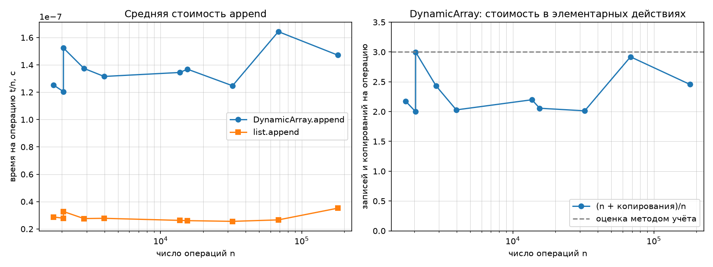
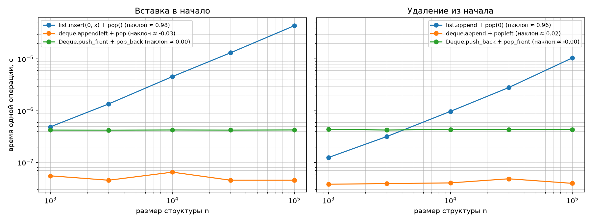

# ЛР 2. Рекурсивные функции и линейные структуры данных

**Вариант:** 13
**Данные:** seed=43

## 1. Рекурсивные функции: Факториал и Фибоначчи

В ходе работы были реализованы рекурсивные функции. Для чисел Фибоначчи проведено сравнение наивной рекурсии и рекурсии с мемоизацией.

**Таблица числа вызовов:**

| n | F(n) | Вызовов (наивно) | Вызовов (мемоизация) |
|---|---|---|---|
| 5 | 5 | 15 | 9 |
| 10 | 55 | 177 | 19 |
| 15 | 610 | 1973 | 29 |
| 20 | 6765 | 21891 | 39 |
| 25 | 75025 | 242785 | 49 |
| 30 | 832040 | 2692537 | 59 |

**Вывод:** Наивная рекурсия имеет экспоненциальную сложность \(O(2^n)\), так как пересчитывает одни и те же подзадачи множество раз (при \(n=30\) происходит более 2.6 млн вызовов). Мемоизация сохраняет результаты в словарь, снижая сложность до линейной \(O(n)\) — количество вызовов растёт линейно (всего 59 вызовов при \(n=30\)).

## 2. Динамический массив (DynamicArray)

Был реализован класс `DynamicArray` с ручным управлением памятью (рост ёмкости ×2).

**Амортизированный анализ `append` (метод учёта):**
При каждой операции `append` мы «начисляем» элементу 3 условные монеты: 1 тратится на саму запись, а 2 откладываются «в кредит». Когда буфер переполняется, нам нужно скопировать все \(k\) элементов в новый массив. На это мы тратим накопленный кредит (2 монеты × \(k/2\) элементов, которые были добавлены с прошлого копирования). Таким образом, средняя стоимость одной операции составляет \(O(1)\), хотя отдельная операция (при переполнении) стоит \(O(n)\).

На графике видно, что величина `(n + копирования) / n` не превышает 3, что подтверждает теорию. Встроенный `list.append` работает в 4–5 раз быстрее за счёт того, что он реализован на C, однако их асимптотика одинакова.

## 3. Сравнение структур: список и дек

Было проведено сравнение вставки и удаления элементов в начале структур при размерах до \(10^5\).

| Операция | Структура | Наклон (log-log) | Асимптотика |
|---|---|---|---|
| Вставка в начало | `list.insert(0, x)` | 0.98 | \(O(n)\) |
| Вставка в начало | `deque.appendleft` | -0.03 | \(O(1)\) |
| Вставка в начало | Свой `Deque` | 0.00 | \(O(1)\) |
| Удаление из начала | `list.pop(0)` | 0.96 | \(O(n)\) |
| Удаление из начала | `deque.popleft` | 0.02 | \(O(1)\) |
| Удаление из начала | Свой `Deque` | -0.00 | \(O(1)\) |

**Вывод:** У стандартного списка `list` вставка и удаление из начала занимают \(O(n)\), так как для этого требуется сдвинуть все остальные элементы в памяти. Дек (как встроенный, так и наш на двусвязном списке) выполняет эти операции за \(O(1)\) (наклон графиков около 0), так как ему достаточно просто переставить указатели на начало и конец.

Наш `Deque` и `Stack` работают в 3–5 раз медленнее встроенных структур (`list` и `collections.deque`) из-за накладных расходов интерпретатора Python (создание объектов, вызовы методов), однако их асимптотическая сложность идентична.

## 4. Верификация

Реализации прошли полную проверку (`self_check`):
1. **Граничные случаи:** пустые структуры, один элемент, опустошение и повторное наполнение.
2. **Инварианты:** проверка роста ёмкости ×2 (`size <= capacity`), порядок LIFO для стека и FIFO для дека.
3. **Сверка с эталоном:** результаты операций собственных структур сверены с `list` и `collections.deque` на случайных сериях операций и на данных варианта.