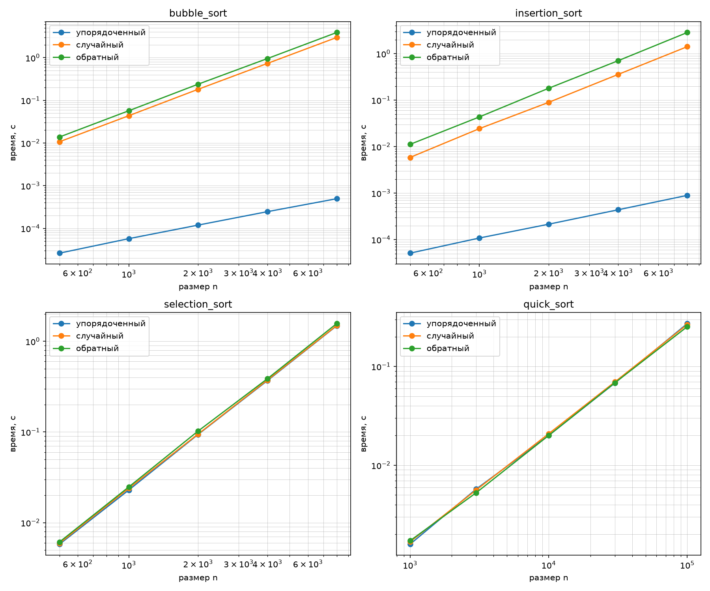

# ЛР 3. Простые сортировки и QuickSort с рандомизацией

**Вариант:** 13
**Seed:** 43

## 1. Демонстрация стабильности

Для проверки стабильности был взят массив пар `(ключ, метка)`: `[(2, 'a'), (1, 'b'), (2, 'c'), (1, 'd')]`. Сортировка производилась только по ключу.

Результаты:
*   **Пузырек (стабильный):** `[(1, 'b'), (1, 'd'), (2, 'a'), (2, 'c')]` — порядок меток `'a'` и `'c'` (а также `'b'` и `'d'`) сохранился.
*   **Вставки (стабильный):** `[(1, 'b'), (1, 'd'), (2, 'a'), (2, 'c')]` — порядок сохранился.
*   **Выбор (НЕстабильный):** `[(1, 'b'), (1, 'd'), (2, 'c'), (2, 'a')]` — метки `'a'` и `'c'` поменялись местами.
*   **QuickSort (НЕстабильный):** порядок равных элементов не гарантируется (в данном запуске совпал, но алгоритм нестабилен в общем случае).

**Вывод:** Пузырек и Вставки стабильны, так как меняют элементы местами только при строгом неравенстве (`>`). Выбор и QuickSort нестабильны, так как производят обмены на большие расстояния.

## 2. Результаты замеров

*(Вставь сюда таблицу из терминала с временами для всех алгоритмов и классов входов)*

## 3. Анализ классов входов и графики

**Пузырек и Вставки:**
*   На **упорядоченном** входе работают за \(O(n)\) (время минимально). У пузырька срабатывает досрочный выход (`swapped == False`), у вставок внутренний цикл `while` сразу прерывается.
*   На **случайном** и **обратном** входах деградируют до \(O(n^2)\).

**Сортировка выбором:**
*   Время работы **одинаково** на всех классах входов (около 1.45–1.55 с при \(n=8000\)). Это подтверждает теоретическую оценку: алгоритм всегда делает ровно \(n(n-1)/2\) сравнений, независимо от исходных данных.

**QuickSort:**
*   Благодаря **рандомизации** опорного элемента, время работы на всех трех классах входов практически одинаково (около 0.25 с при \(n=100000\)). Алгоритм не деградирует в \(O(n^2)\) на упорядоченных данных, обеспечивая стабильную \(O(n \log n)\).

## 4. Верификация

*   **Инварианты:** проверено, что результат каждой сортировки упорядочен и является перестановкой входа (на пустом массиве, одном элементе, массиве равных элементов, отсортированном и обратном).
*   **Сверка с эталоном:** результаты всех реализаций совпали со встроенной функцией `sorted()` на 300 случайных массивах.
*   **Счётчики:** проверено, что сортировка выбором делает ровно \(n(n-1)/2\) сравнений (для \(n=5\) это 10).